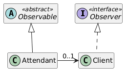

# Observer-DCC078-2026-3-A
## Tema:
Simulação de um sistema de fila eletrônica, onde cada novo cliente recebe um id e uma instância única de atendente notifica a todos os clientes ativos qual o id do próximo cliente a ser atendido.
## Diagramas:
